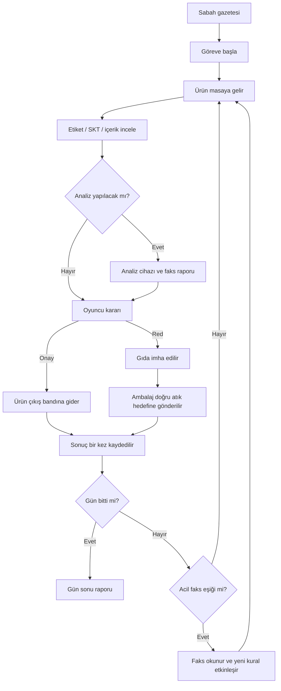

# GameUP32 — Uygulama Planı

> Hedef: 24 saat veya daha kısa sürede, Windows PC için baştan sona tamamlanabilen bir jam oyunu.
> Çekirdek kapsam: tek oda, sabit masa başında birinci şahıs bakış, iki oyun günü, 12 ürün, bir acil faks.
> Unity Editor: **6000.3.13f1**.
> Bu dosya uygulama planıdır. Görev kutuları tamamlanmış iş veya yapılmış test anlamına gelmez.

**Güncel entegrasyon:** Faruk'un üretim kuralları, Özgür'ün etkileşimi ve ürün sanatları `feat/lead-day-flow` dalında birleştirilmiştir. Başlangıç **First → Menu → Game**; Antalya COP31 menüsü, ayarlar, iki gün/12 ürün, belge/faks ve sonuçlar kayıtlı sahnelerle bağlanmıştır. Güncel kullanım ve doğrulama için [LEAD_INTEGRATION.md](LEAD_INTEGRATION.md), görsel kaynakları için [ART_DIRECTION.md](Assets/Art/Menu/ART_DIRECTION.md). Aşağıdaki planın başlangıç durumu ve görev kutuları tarihsel planı korur.

**Gazete / oda düzenlemesi:** `feat/lead-newspaper-room` dalı; kâğıt dokulu gazete baskısını, arkaya alınmış geri dönüşüm istasyonunu, geniş odayı ve COP31 afişlerini içerir. Esmanur'un 31 prefabı bağlıdır: 5 oynanış, 26 numune/teşhir. Ayrıntılı [model envanteri](Docs/MODEL_INVENTORY.md) ve [35/35 doğrulama sonucu](VALIDATION.md).

## 1. Kaynak, mevcut durum ve çalışma kararları

- Ana kaynak: [GameUP32 Google Dokümanı — ekip planı](https://docs.google.com/document/d/1_49KPVdyfkgs8Qj4Isu6FLydY0bF-rlG-tH7xH6udXY/edit?tab=t.ha6zdj2y0k6).
- İlk fikir listesi: [aynı dokümanın ilk sekmesi](https://docs.google.com/document/d/1_49KPVdyfkgs8Qj4Isu6FLydY0bF-rlG-tH7xH6udXY/edit?tab=t.0).
- Dördüncü kişinin teknik liderlik, akış ve teslim işleri bölüm 14.4'te ayrıntılandırılmıştır.
- Plan tarihi: 31 Ekim 2026, Europe/Istanbul.
- İncelenen güncel depo tabanı: `6275558` (`Unity proje dosyalari eklendi`). Unity projesi, URP ayarları, Input System asset'i ve `SampleScene` vardır; oyuna özgü oynanış scriptleri henüz eklenmemiştir. Aşağıdaki yeni script ve asset adları oluşturulacak yapıyı tarif eder.
- Mevcut proje: `GameUp-32`; `ProjectVersion.txt` sürümü `6000.3.13f1`. Manifestte URP `17.3.0`, Input System `1.19.0`, uGUI `2.0.0` ve Test Framework `1.6.0` bulunur. Proje ayarındaki `activeInputHandler: 1`, Input System kullanımıyla uyumludur.
- Sürüm kaynağı: [Unity 6000.3.13f1](https://unity.com/releases/editor/whats-new/6000.3.13f1).

Kaynakta kesinleşmemiş konuları uygulanabilir hâle getirmek için alınan kararlar:

| Konu | Bu planın kararı |
| --- | --- |
| Süre ve platform | En fazla 24 saat, Windows x64 |
| Ürün grupları | P0: süt ürünleri ve balık; diğer gruplar P1 |
| Hareket | Sabit masa, fareyle bakış; serbest dolaşma P0 kapsamında yok |
| `W (Legit)` | W = onay varsayımı; ilk saat ekipçe kesinleştirilir |
| Analiz | Ürüne yazılmış gizli veriden rapor; sonuç işlem sırasında rastgele üretilmez |
| Acil faks | İkinci gün, üçüncü ürün tamamen bitince; dördüncü üründen itibaren geçerli |
| Zaman | Gerçek zaman sayacı yerine ürün sırasına bağlı kurgu saati |
| Giriş | Kısa görev metni; cutscene sonraya bırakılır |
| Veri ve olay isimleri | İlk 30 dakikada sabitlenecek önerilen sözleşme |

Olaylar, haberler, analizler ve gıda eşikleri oyun kurgusudur. Özellikle aşağıdaki örnek ürün verileri gerçek üretici, parti, ürün kalitesi veya mevzuat hakkında iddia içermez.

## 2. Oyun amacı ve oynanış döngüsü

Oyuncu, oyunun kurgusunda COP31 Antalya görevlisidir. Masasına gelen ürünleri inceler; güvenli ve kurallara uygun ürünleri piyasaya gönderir, hatalı ürünleri reddeder ve atık akışını tamamlar. Çevre ve iklim krizi, gazete haberlerinin yanında oyuncunun uyguladığı kurallarda da görünür.



**Ürünün fiziksel yönü oyuncunun kararına bağlıdır.** Oyuncu geçersiz bir ürünü onaylarsa ürün banttan çıkar ve karar hata sayılır. Sistem oyuncunun kararını gizlice düzeltip ürünü çöpe göndermez.

## 3. Kapsam ve kaynak gereksinimlerinin karşılığı

P0 teslim için zorunludur. P1, bütün P0 işleri build üzerinde çalıştıktan sonra açılır. 18. saatten sonra yeni özellik eklenmez.

| Gereksinim | Öncelik | Uygulama | Birincil sahip |
| --- | --- | --- | --- |
| 3D ve birinci şahıs | P0 | Sabit masa ve fareyle bakış | Özgür |
| Resident Evil benzeri inceleme | P0 | Yakına alma, döndürme, etiketi okuma, yerine koyma | Özgür |
| Ürünlerin sırayla gelmesi | P0 | Aynı anda bir aktif ürün; sabit noktalar arasında hareket | Özgür + teknik lider |
| Kategoriye özel el kitapçığı | P0 | Aktif kural verisinden üretilen kısa sayfalar | Faruk + teknik lider |
| SKT denetimi | P0 | Oyunun tarihine göre karşılaştırma | Faruk |
| Beyan–içerik uyumsuzluğu | P0 | Ön yüz iddiası ile arka etiket türü/içeriğini karşılaştırma | Faruk |
| Dört yerel süt ürünü | P0 | Ortak modellerin etiket varyasyonları | Tasarımcı + Faruk |
| Analiz cihazı | P0 | Gizli kirlilik verisini kısa işlemden sonra raporlama | Faruk + Özgür |
| Analiz raporunun fakstan çıkması | P0 | Basit kâğıt hareketi, ses ve okunabilir belge | Teknik lider |
| Günlük gazete | P0 | Haber, kategori ve uygulanacak kurallar | Teknik lider + Faruk |
| Caretta caretta haberleri | P0 | İkinci gün gazetesi ve bir görsel | Teknik lider + tasarımcı |
| Bakanlık acil faksı | P0 | B bölgesi dip balıkları için yeni yasak | Teknik lider + Faruk |
| Ayrıştırılmış atık | P0 | Gıda imhası ile ambalaj hedefini ayırma | Özgür + Faruk |
| Tartı | P1 | Görünür gerçek ağırlık ile etiket beyanını karşılaştırma | Özgür + Faruk |
| Cetvel | P1 | Tek bir açık uzunluk kuralı; ölçü birimi kitapçıkta | Özgür + Faruk |
| Muzlu gofret / meyve yüzdesi | P1 | Aynı içerik sistemiyle kurmaca ürün ve açık yüzde eşiği | Faruk |
| Et, sebze, meyve günleri | P1 | Yeni gün ve ürün verileri; yeni ana döngü yazılmaz | Faruk + teknik lider |
| Giriş cutscene'i / alıntı | Ertelendi | P0'da kısa görev metni; alıntı eklenirse kaynağı doğrulanır | Teknik lider |

P0 dışında: açık dünya, NPC, envanter, serbest fırlatma fiziği, çok oyunculu yapı, ekonomi, kayıt/yükleme, dallanan hikâye ve ayrıntılı ambalaj sökme animasyonu.

## 4. Ekip sahipliği ve çalışma sınırları

| Kişi | Sahip olduğu alan | Teslim aldığı bağımlılık | Teslim ettiği sonuç |
| --- | --- | --- | --- |
| 1 — 3D tasarımcı | Modeller, materyaller, etiket yüzeyleri, oda düzeni için görseller | Ölçek/pivot standardı ve cihaz yerleşimi | Unity'ye aktarılabilir görseller |
| 2 — Özgür / 0zeeE | Kamera, inceleme, fiziksel ürün hareketi, hedefler ve atık etkileşimi | Ortak veri sözleşmesi ve geçici modeller | Oyuncu komutları ve görsel işlem bitişleri |
| 3 — Faruk | Ürün verileri, kurallar, analiz sonucu, değerlendirme ve sonuç kaydı | Gün/kural kapsamı ve olay sözleşmesi | Tek kaynaktan doğru kararlar ve gün özeti |
| 4 — teknik lider | Proje, gün akışı, belgeler, öğretici, entegrasyon ve build | Diğer üç kişinin küçük ve sık teslimleri | Baştan sona oynanabilir Windows paketi |

Kurallar:

1. Ana sahneyi teknik lider düzenler. Diğerleri kendi test sahnesi/prefabı üzerinde çalışır.
2. Ürünün geçerliliğini yalnızca Faruk'un değerlendirme sistemi hesaplar.
3. Ürün sırasını yalnızca teknik liderin gün akışı ilerletir.
4. Nesne hareketlerini yalnızca Özgür'ün sunum/etkileşim bileşenleri yürütür.
5. Kitapçıkta gösterilen eşik ve koşullar kural verisinden gelir; arayüzde ayrı bir kural kopyası tutulmaz.
6. Görsel asset gecikmesi kodu durdurmaz; küp, kapsül ve düz renkli malzemelerle devam edilir.

## 5. Başlangıç yapısı ve Unity kurulumu

Mevcut proje üzerinden devam edilir: Editor `6000.3.13f1`, render pipeline URP, giriş sistemi Input System. `Assets/InputSystem_Actions.inputactions` ortak aksiyon tanımları için başlangıçtır. İlk saat ekip bu ayarları doğrular; jam sırasında pipeline veya ana giriş sistemi değiştirilmez. Ek bir framework, DI container veya genel amaçlı kural motoru P0 için gerekli değildir.

Mevcut `Assets/Art`, `Assets/Prefabs`, `Assets/Scenes` ve `Assets/Scripts` yerleşimi korunarak önerilen genişleme:

```text
Assets/
  Art/
    Models/
    Materials/
    Textures/
  Audio/
  Data/
    Products/
    Days/
    Rules/
    Documents/
  Prefabs/
    Player/
    Products/
    Stations/
    UI/
  Scenes/
    SampleScene.unity # Mevcut başlangıç sahnesi
    Main.unity        # Teknik lider oluşturursa ana oynanış sahnesi
    Tests_Interaction.unity
    Tests_Rules.unity
  Scripts/
    Contracts/       # Ortak veri tipleri ve olay yükleri
    Core/            # Teknik lider: başlangıç, gün akışı, oturum
    Interaction/     # Özgür: kamera, inceleme, ürün hareketi
    Rules/           # Faruk: değerlendirme, analiz, sonuçlar
    UI/              # Teknik lider: belgeler, HUD, sonuçlar
  Settings/          # Mevcut URP ayarları
  InputSystem_Actions.inputactions
```

Mevcut build sahnesi `Assets/Scenes/SampleScene.unity` olarak kayıtlıdır. Teknik lider bu sahneyi oynanışa dönüştürebilir veya `Main.unity` oluşturup build sahnesini güncelleyebilir; ekip tek ana sahnede anlaşır. Sırf bu klasör önerisine uymak için mevcut asset'ler taşınmaz ve GUID'ler yenilenmez.

Ana sahnenin önerilen nesneleri:

```text
Main
  Systems
    GameBootstrap
    DayFlowController
    InspectionService
    AnalysisService
    RunResults
  PlayerRig
    Camera
    InteractionRay
    InspectionAnchor
  Workstation
    ArrivalPoint
    DeskPoint
    ApprovedExitPoint
    FoodDisposalPoint
    AnalyzerSlot
    PackagingSlot
    FaxPaperSlot
    WasteTargets
      Paper
      Glass
      Plastic
      Contaminated
  UI
    HUD
    DocumentPresenter
    TutorialPresenter
    SummaryPresenter
```

Başlangıç kontrolü:

- [ ] `Assets`, `Packages` ve `ProjectSettings` repoda; `.meta` dosyaları korunuyor.
- [ ] Editor sürümü proje ayarlarında doğrulanmış.
- [ ] Ana sahne Windows build profiline eklenmiş.
- [ ] Türkçe karakterleri gösterebilen font seçilmiş.
- [ ] İlk küçük Windows build'i başka ekip üyesinde açılmış.

## 6. Veri modeli

Bu bölüm alan/sorumluluk sözleşmesidir; dosya bu sınıfların uygulanmış olduğunu iddia etmez. Tip adlarını ilk 30 dakikada kesinleştirin. P0 için birkaç basit C# veri tipi, ScriptableObject tanımı ve doğrudan referans yeterlidir.

### 6.1 Kalıcı tasarım verisi

| Tip | Temel alanlar | Sahip |
| --- | --- | --- |
| `ProductDefinition` | `DefinitionId`, kategori, görünen ad, prefab, etiket metinleri, SKT, beyan edilen tür, listelenen tür/içerik, kaynak bölge, habitat, kirlilik verisi, ambalaj malzemesi ve ambalaj kontaminasyonu | Faruk |
| `RuleDefinition` | `RuleId`, kural türü, kategori kapsamı, parametreler, oyuncuya gösterilen açıklama | Faruk |
| `DayDefinition` | `DayId`, oyun tarihi, sıralı ürün listesi, başlangıç kural kimlikleri, gazete, isteğe bağlı acil olay | Faruk + teknik lider |
| `EmergencyDefinition` | Kaç ürün tamamlandıktan sonra tetikleneceği, yeni kural kimliği, gösterilecek saat ve faks metni | Teknik lider + Faruk |
| `DocumentDefinition` | Belge türü, başlık, gövde, görsel, isteğe bağlı ilgili kural kimlikleri | Teknik lider |

12 örnek için her senaryoya bir ürün asset'i tanımlamak yeterlidir. Aynı fiziksel model birçok asset tarafından kullanılabilir.

### 6.2 Oturum verisi

| Tip | Temel alanlar | Kural |
| --- | --- | --- |
| `RunContext` | `RunId`, gün indeksi, tamamlanan sonuçlar | Her yeniden başlatmada yeni `RunId` |
| `ProductSession` | `RunId`, `ProductId`, tanım referansı, `RuleSnapshot`, analiz/karar/ayrıştırma durumu | Her masaya geliş için tek oturum |
| `RuleSnapshot` | Sürüm, oyun tarihi, aktif kuralların sabit kopyası | Ürün başladıktan sonra değişmez |
| `AnalysisReport` | `RunId`, `ProductId`, `ReportId`, bulgu ve rapor metni | Yalnızca ilgili ürüne bağlanır |
| `DecisionEvaluation` | Beklenen karar, oyuncu kararı, doğruluk, neden kimlikleri ve kural sürümü | Hesaplama puan kaydından ayrıdır |
| `ProductOutcome` | Karar değerlendirmesi, varsa ayrıştırma sonucu, puan farkı | Ürün başına bir kez kaydedilir |

`analiz edildi`, `karar verildi`, `puanlandı` gibi çalışma durumları ScriptableObject asset'lerine yazılmaz. Böylece yeniden başlatmada veya Editor'da tekrar Play'e basıldığında önceki oturum sızmaz.

Snapshot yalnızca aktif listeye bir referans değildir: ürünün değerlendirme koşulları sonradan değişmeyecek şekilde sabitlenir. Acil olay, eski snapshot içindeki ortak bir `IsActive` alanını değiştirmez.

Görünür bilgiler: ad, SKT, içerik/tür, kaynak, dip/yüzey bilgisi ve ambalaj etiketi. Kirlilik verisi analiz raporu çıkana kadar gizlidir. Beklenen karar ve hata nedenleri karar öncesinde oyuncuya gösterilmez.

## 7. Olay ve yöntem sözleşmesi

Her ürünle ilişkili yük `RunId` ve `ProductId` taşır. Yanlış oturuma veya eski ürüne gelen olay akışı ilerletmez. Olaylar basit C# event/callback ile bağlanabilir; genel bir event bus zorunlu değildir.

| Komut / olay | Yön | Yük ve anlam |
| --- | --- | --- |
| `BeginProduct` | Teknik lider → Özgür / Faruk | Ürün oturumu ve o ürüne sabitlenmiş kurallar |
| `ArrivalFinished` | Özgür → teknik lider | Ürün incelemeye hazır |
| `AnalysisRequested` | Özgür → teknik lider → Faruk | Aktif ürün için analiz isteği |
| `AnalysisReady` | Faruk → teknik lider | Kimlikli rapor; teknik lider faks sunumuna verir |
| `DecisionSubmitted` | Özgür → teknik lider | `Approve` veya `Reject`; oyuncunun seçimi |
| `DecisionEvaluated` | Faruk → teknik lider | Sabit kural kopyasıyla hesaplanan doğruluk/nedenler |
| `DispositionFinished` | Özgür → teknik lider | Oyuncunun seçtiği onay/red hareketi tamamlandı |
| `SortingFinished` | Özgür → teknik lider → Faruk | Ambalaj hedefe yerleşti; seçilen kutu kimliği |
| `CommitOutcome` | Teknik lider → Faruk | Nihai ürün sonucunu bir kez kaydet |
| `ProductCompleted` | Teknik lider → akış / UI | Sonuç kaydedildi; sıradaki ürüne geçilebilir |
| `EmergencyAcknowledged` | Belge arayüzü → teknik lider | Oyuncu acil faksı okuduğunu onayladı |
| `ActivateEmergency` | Teknik lider → Faruk | Sonraki ürünler için kuralı etkinleştir |
| `GetDaySummary` | Teknik lider → Faruk | Günün kayıtlı sonuçlarını al |

**Fiziksel işlem bitişi ve iş kaydı ayrıdır.** `DispositionFinished`, reddedilmiş üründe ayrıştırma sürüyorsa `ProductCompleted` üretmez.

Onay akışı:

1. Aktif ürüne ait, ilk ve izin verilen `DecisionSubmitted` kabul edilir.
2. Faruk değerlendirmeyi döndürür; seçilmiş karar artık değiştirilemez.
3. Özgür ürünü onay çıkışına götürür.
4. `DispositionFinished` sonrasında sonuç bir kez kaydedilir.
5. Teknik lider `ProductCompleted` ile sırayı ilerletir.

Red akışı:

1. Karar aynı şekilde doğrulanır ve değerlendirilir.
2. Özgür gıda imha hareketini tamamlar.
3. Ambalaj/atık seçimi açılır.
4. Oyuncu kutuyu seçer; nesne hedefe ulaştığında `SortingFinished` gelir.
5. Faruk ayrıştırmayı değerlendirir; birleşik sonuç bir kez kaydedilir.
6. Teknik lider sırayı ilerletir.

Hatalı ayrıştırma da terminal sonuçtur; tekrar denemeye zorlayıp akışı kilitlemez. Kaydedilmiş aynı ürüne gelen tekrar olayları ikinci puan veya ikinci ürün geçişi üretmez.

## 8. Durum yönetimi ve etkileşim izni

### 8.1 Küresel durum — teknik lider

| Durum | İş | Çıkış |
| --- | --- | --- |
| `Boot` | Referanslar, oturum, ilk gün | Başlangıç tamam |
| `MorningBriefing` | Gazete ve görev talimatları | Göreve başla |
| `Working` | Tek aktif ürünün işlenmesi | Ürün tamam / gün sonu / acil eşik |
| `EmergencyBriefing` | Işık, ses, zorunlu acil belge | Acil faks onayı |
| `DaySummary` | Gün sonuçları | Devam |
| `GameSummary` | Toplam sonuç, tekrar oyna, çıkış | Yeniden başlat / çıkış |

### 8.2 Yerel etkileşim durumu — Özgür

`Arriving → OnDesk ↔ Inspecting → Analyzing / Routing → AwaitingSort → Finished`

Bu sıra izin verilen dallarla uygulanır: onaylanan ürün `AwaitingSort` aşamasını atlar. Analizden sonra ürün masaya döner. İnceleme ve analiz sırasında ikinci bir nesne oluşturulmaz.

### 8.3 Girdi kilidi

- Belge açıkken kamera, ürün kararı ve dünya etkileşimi durur; belge arayüzü çalışır.
- Ürün hareket ederken veya analiz sürerken onay/red alınmaz.
- Belge kapanması bütün kilitleri koşulsuz kaldırmaz. Küresel durum ve yerel işlem hâlâ izin vermelidir.
- `Escape`: normal belgeyi veya incelemeyi kapatır. Sabah görevi ve acil kural geçişi, açık devam/onay düğmesiyle tamamlanır; Escape ile atlanmaz.
- Analiz raporu geldiğinde başka belge açıksa mevcut belge ezilmez; rapor bekler.
- P0'da kayıt/yükleme yoktur; yeniden başlatma tüm oturumu temizler.

Önerilen tuşlar: E = etkileşim, fare sürükleme = incelemede döndürme, W = onay, R = red. Ekranda onay/red düğmeleri de bulunur. Serbest dolaşma eklenirse W çakışması giderilmeden yayımlanmaz.

## 9. Kurallar ve değerlendirme

Faruk'un sistemi basit, açık kontroller uygular. P0 için yapılandırılabilir dört kontrol yeterlidir.

| Kural kimliği | Kapsam | Geçersizlik koşulu | Oyuncunun kanıtı |
| --- | --- | --- | --- |
| `R_EXPIRY` | Her iki gün | `ExpiryDate < GameDate` | SKT ve görünen oyun tarihi |
| `R_IDENTITY` | Süt ürünleri | Beyan edilen ürün türü ile arka etiketteki tür/içerik uyumsuz | Ön ve arka etiket |
| `R_POLLUTION` | Balık | Ürünün kirlilik verisi pozitif | Analiz raporu |
| `R_SOURCE_BAN` | Acil faks sonrası balık | Kaynak B **ve** habitat dip balığı | Acil faks ve ürünün kaynak/habitat etiketi |

En az bir geçersizlik koşulu varsa beklenen karar `Reject`, yoksa `Approve` olur. Birden fazla neden varsa hepsi sonuçta tutulabilir; ilk öğretici ürünler tek neden taşır.

Bu oyunda SKT'nin oyun tarihine eşit olması geçerlidir. Bu, veri ve kitapçıkta aynı yazılacak bir oyun sınır kararıdır. SKT bütün tehlikeleri açıklamaz; temiz tarihli bir ürün analiz veya kaynak yasağı nedeniyle reddedilebilir.

Analiz yapmadan karar vermek ayrıca bir usul puanı kuralı değildir. Oyuncu rapor almadan risk alabilir; kirliliği yanlış tahmin ederse ürün kararı hatalı olur. Analiz sürerken karar girişi geçici olarak kapalıdır. Tek üründe yeniden analiz isteği aynı bulguyu verir ve ikinci bir sonuç kaydı oluşturmaz.

Değerlendirme ile puan kaydı ayrılır: `Evaluate` sonuç üretir, `CommitOutcome` ürünün terminal sonucunu kaydeder. Aynı ürün tekrar değerlendirilse bile yalnızca tek sonuç puanlanır.

### 9.1 Puan ve başarı koşulu — başlangıç ayarı

| İşlem | Puan |
| --- | ---: |
| Doğru onay veya doğru red | +10 |
| Sağlam ürünü reddetme | -10 |
| Geçersiz ürünü piyasaya gönderme | -15 |
| Doğru ambalaj/atık hedefi | +2 |
| Yanlış ambalaj/atık hedefi | -2 |

Finalde başarı etiketi için karar doğruluğu en az %75 olmalıdır: 12 üründe en az 9 doğru karar. Ayrıştırma puanı bu koşulun yerine geçmez. Örnek listede 6 geçerli, 6 geçersiz ürün vardır; her şeyi onaylamak veya reddetmek %50 doğruluk verir ve başarısızdır.

Gün sonunda doğru karar, hatalı kabul, hatalı red ve doğru ayrıştırma ayrı gösterilir. Ayrıştırma paydası, gerçekten ayrıştırılan reddedilmiş ürün sayısıdır; hiç red yoksa `0/0` yerine `—` gösterilir.

## 10. On iki ürünlük uygulanabilir içerik

Bu tablo başlangıç fixture'ıdır. Tarihler, içerikler ve kirlilik verileri kurmacadır. Gün 1 oyun tarihi `01.11.2026`, gün 2 oyun tarihi `02.11.2026` olarak seçilmiştir; gerçek etkinlik takvimi iddiası değildir.

### 10.1 Gün 1 — süt ürünleri

Başlangıç kuralları: `R_EXPIRY`, `R_IDENTITY`. Dört yerel ürün adı etiketlerde görünür. İlk ürün doğru, ikinci ürün yalnızca SKT yüzünden hatalıdır.

| Sıra / kimlik | Ürün | Kanıt / veri | Beklenen karar | Red verilirse ambalaj hedefi |
| --- | --- | --- | --- | --- |
| 1 / `D1-01` | Korkuteli Yanıksı Dondurması | SKT 03.11.2026; tür/içerik uyumlu | Onay | Kâğıt |
| 2 / `D1-02` | Aynı ürünün farklı kurmaca partisi | SKT 31.10.2026; diğer bilgiler uyumlu | Red: SKT | Kâğıt |
| 3 / `D1-03` | Antalya Yörük Peyniri | SKT 04.11.2026; tür/içerik uyumlu | Onay | Plastik |
| 4 / `D1-04` | Akseki Tulum Peyniri | SKT 01.11.2026; tür/içerik uyumlu | Onay: tarih sınırı örneği | Kâğıt |
| 5 / `D1-05` | Keçi Sütü Kaymağı | SKT 31.10.2026; tür/içerik uyumlu | Red: SKT | Cam |
| 6 / `D1-06` | Sütlü dondurma iddialı kurmaca ürün | SKT geçerli; arka etikette tür: sütlü buz | Red: beyan/tür uyumsuzluğu | Plastik |

Gazete taslağı:

> **Sıcak hava, gıda taşımacılığını gündeme taşıdı**
> Antalya'daki sıcaklıkların ardından süt ürünleri sevkiyatlarında denetimler artırıldı. Yerel üretimin korunması için ürün bilgileri dikkatle kontrol ediliyor.

Görev kutusu: **Bugün SKT'yi ve ürünün ön yüzündeki iddiayı arka etiketindeki tür/içerikle karşılaştır.** P0'da sıcaklık ölçümü veya soğuk zincir sensörü yoktur; haber böyle bir araç varmış gibi görev vermez.

### 10.2 Gün 2 — balık ve acil faks

Başlangıç kuralları: `R_EXPIRY`, `R_POLLUTION`. Bütün balıkların SKT'si bu örnekte geçerlidir. Üçüncü ürün bittikten sonra `R_SOURCE_BAN` eklenir.

| Sıra / kimlik | Kaynak / habitat | Analiz | Beklenen karar | Red verilirse ambalaj hedefi |
| --- | --- | --- | --- | --- |
| 1 / `D2-01` | B / dip | Temiz | Onay: henüz yasak yok | Plastik |
| 2 / `D2-02` | A / yüzey | Kirletici pozitif | Red: kirlilik | Kontamine atık |
| 3 / `D2-03` | A / yüzey | Temiz | Onay | Plastik |
| **Acil faks** | **Saat 12.00 gösterilir** | **Sonraki ürün bekler** | **Yeni kural onayla etkinleşir** | **—** |
| 4 / `D2-04` | B / dip | Temiz | Red: kaynak yasağı | Plastik |
| 5 / `D2-05` | B / yüzey | Temiz | Onay: yasak bütün B ürünlerini kapsamaz | Plastik |
| 6 / `D2-06` | A / yüzey | Kirletici pozitif | Red: kirlilik devam eden bağımsız kural | Kontamine atık |

Gazete taslağı:

> **Deniz kirliliği ve caretta carettalar için uyarı**
> Kıyıda bulunan bir caretta carettanın ardından plastik kirliliği yeniden gündeme geldi. Görevliler deniz canlılarından alınan örneklerin incelendiğini bildirdi.

Görev kutusu: **Balıkların kaynak ve habitat etiketlerini incele. Kirlilik etiket üzerinden anlaşılamaz; analiz raporunu kontrol et.**

Acil faks taslağı:

> **BAKANLIK ACİL FAKSI — 12.00**
> B bölgesinde sızıntı bildirildi. Bu saatten sonra gelen B bölgesi dip balıkları, analiz sonucu temiz görünse bile tedbir kapsamında reddedilecektir.
> Kapsam: **kaynak B + dip balığı**. Önceki sevkiyatların kararları değiştirilmez.

Bu kural tedbir yasağıdır; temiz raporun sonradan rastgele zehirli rapora dönmesi değildir. `D2-01` ile `D2-04`, aynı özelliklerin farklı kural sürümlerindeki sonucunu gösterir. `D2-05` ise oyuncunun bütün B ürünlerini reddetmesini önler.

## 11. Acil faksın kesin geçiş davranışı

Sahip: teknik lider. Kuralın içeriği ve uygulanması: Faruk.

1. Gün 2'de üç ürünün sonuçları tamamen kaydedilir; üçüncü ürünün ayrıştırması varsa o da bitmiştir.
2. `EmergencyTriggered` işaretlenir. Tekrarlanan tamamlanma olayı ikinci faks oluşturmaz.
3. Akış `EmergencyBriefing` olur. Yeni ürün oluşturulmaz.
4. Saat 12.00 olarak gösterilir; kırmızı ışık, ses ve belge sunulur.
5. Oyuncu belgeyi okuyup açık onay düğmesine basar.
6. Faruk'un kural sistemine yasak eklenir; kitapçığın güncel kural görünümü yenilenir.
7. Yeni `RuleSnapshot` ile dördüncü ürün başlar.
8. Önceki ürünlerin snapshot ve kayıtları değişmez.

Faksı daha sonra yeniden açmak kuralı tekrar eklemez. Belge yalnızca kapatılmışsa ve onaylanmamışsa akış devam etmez. Örnek saatin gerçek saniye sayacıyla ilerlemesi gerekmez.

## 12. Atık ayrıştırma

Gıda ve ambalaj ayrı çıktıdır. Jam uygulaması:

1. Oyuncu red verir.
2. Gıda, imha alanına kısa hareketle gider.
3. Ayrıntılı açma/boşaltma animasyonu yerine bir ambalaj nesnesi veya seçim kartı görünür.
4. Oyuncu ambalajı kâğıt, cam, plastik veya kontamine atık hedefine gönderir.
5. Yanlış seçim puanlanır ve ürün tamamlanır; aynı seçim tekrar puanlanmaz.

Beklenen hedef, ambalaj malzemesi ve açık kontaminasyon verisinden hesaplanır. Kirli ambalaj sırf cam/plastik olduğu için temiz geri dönüşüm sayılmaz. Örnekte `D2-02` ve `D2-06` için ambalaj kontaminasyonu da açıkça işaretlidir; tedbir yasağı altındaki temiz `D2-04` ambalajı plastik olarak kalır.

Kutularda isim ve ikon bulunur. Kontamine atık için ayrı hedef vardır; organik gıda ile cam kutusu aynı anlamda kullanılmaz. Kaynakta geçen diğer malzemeler P1'de aynı veri modeline eklenebilir.

## 13. Belge, faks ve öğretici arayüzü

Sahip: teknik lider. P0'da tek bir `DocumentPresenter` kullanılır.

| Belge | İçerik | Açılma / kapanma davranışı |
| --- | --- | --- |
| Gazete | Başlık, kısa haber, günün görevleri, görsel | Gün başında; göreve başla düğmesiyle ilerler |
| Kitapçık | Kategori kuralları, tarih, aktif acil ek | İstenildiğinde açılır; normal kapatılabilir |
| Analiz raporu | Ürün kimliği, bulgu, rapor numarası | Faks üretince erişilir; başka belgeyi ezmez |
| Acil faks | Yeni kural, kapsam ve yürürlük noktası | Ürünler arasında; açık onay gerekir |

İlk iki ürünün öğreticisi:

1. Ürünü incele ve etiketi bul.
2. Oyun tarihi ile SKT'yi karşılaştır.
3. Kitapçıktaki kuralı kontrol et.
4. Onay/red ver.
5. Red ürününde ayrıştırmayı tamamla.

Adımlar ilgili gerçek etkileşim gerçekleştiğinde ilerler. Uzun metin duvarı, zorunlu seslendirme ve ayrı tutorial sahnesi gerekmez.

Hedef kontrol: 1920×1080 ve 1280×720 çözünürlükte SKT, kaynak, habitat ve rapor okunabilir. Bilgi yalnızca renk veya sesle verilmez.

## 14. Rol bazlı uygulanacak işler

Her görev için: sahip işi uygular, bağımlılığı sağlayan kişi küçük bir teslim verir, kabul ölçütü ana sahne veya ilgili test sahnesinde kontrol edilir.

### 14.1 Kişi 1 — 3D tasarımcı

| ID | İş ve bağımlılık | Teslim / kabul ölçütü |
| --- | --- | --- |
| A01 | İlk 30 dakikada teknik liderle ölçek, pivot, etiket yüzeyi ve yerleşim belirle | Metre ölçeği ve tutarlı pivotla geçici modeller Unity'de duruyor |
| A02 | Masa, küçük oda, giriş ve çıkış bandı | Kamera açısından bütün önemli hedeflere erişiliyor |
| A03 | Dondurma kabı, peynir ambalajı, kaymak kavanozu, balık | Dört ana model birçok ürün tanımıyla kullanılabiliyor |
| A04 | Analiz cihazı ve faks | Ürün yuvası, kâğıt çıkışı ve uyarı ışığı yeri belli |
| A05 | Ortak kutu modeli, malzeme varyasyonları ve ikonlar | Kâğıt/cam/plastik/kontamine hedefleri yazıyla ayırt ediliyor |
| A06 | Yerel etiketler, Antalya ve caretta görselleri | Dört yerel isim ve caretta gazetesi oyunda görünür |

İlk teslim düz renkli modellerdir. Küçük metinler sabit texture'a gömülmek yerine mümkünse değiştirilebilir etiket alanına konur. Detaylandırma, etkileşim yerleşimi doğrulandıktan sonra yapılır.

### 14.2 Kişi 2 — Özgür, etkileşim

| ID | İş | Bağımlılık | Kabul ölçütü |
| --- | --- | --- | --- |
| I01 | Kamera ve etkileşim ışını | L01, ortak giriş kararı | Hedef adı/komutu görünür; sabit masadan bakılabilir |
| I02 | İnceleme konumu, döndürme ve geri bırakma | I01, A01 | Ön/arka etiket okunur; nesne kaybolmaz |
| I03 | Giriş–masa–çıkış hareketi | Ortak ürün kimliği | Aynı anda tek ürün; bitiş olayları kimlikli |
| I04 | Analiz cihazı etkileşimi | R03, sözleşme | Doğru ürüne tek analiz isteği gider |
| I05 | Onay/red ve hareket kilitleri | I03, R04 | Çift komut kabul edilmez; yön oyuncu kararına bağlı |
| I06 | Gıda imhası ve ambalaj hedefleri | R05, A05 | Ayrıştırma bitmeden ürün tamamlanmaz |
| I07 | Belge/işlem kilitleriyle uyum | L03 | Belge açıkken dünya etkileşimi yok; kapatınca doğru kontrol döner |
| I08 | Prefab teslimi ve ana sahne kontrolü | I01–I07 | En az bir doğru ve bir hatalı karar akışı build'de çalışır |

### 14.3 Kişi 3 — Faruk, veri ve kurallar

| ID | İş | Bağımlılık | Kabul ölçütü |
| --- | --- | --- | --- |
| R01 | Ortak veri tipleri ve ürün oturumu | İlk 30 dakika sözleşmesi | Kimlikler, runtime durum ve tasarım verisi ayrılmış |
| R02 | Dört P0 kuralı ve açıklama verileri | R01, bölüm 9 | Aynı veri/snapshot aynı sonucu verir |
| R03 | Analiz servisi | R01 | Gizli veriyle tutarlı, kimlikli rapor; tekrar istek farklı sonuç üretmez |
| R04 | Karar değerlendirme | R02 | Beklenen karar, doğruluk ve nedenler döner; henüz çift puan üretmez |
| R05 | Ayrıştırma değerlendirme ve sonuç kaydı | R01, R04 | Temiz/kontamine ayrımı; ürün başına tek terminal kayıt |
| R06 | Acil kural etkinleştirme ve snapshot | R02, L06 | Önceki ürün sonuçları değişmeden sonraki kurallar güncellenir |
| R07 | 12 ürün, iki gün ve başlangıç kuralları | Bölüm 10 | 6 geçerli/6 geçersiz; bütün ipuçları erişilebilir |
| R08 | Gün özeti ve yeniden başlatma temizliği | R05 | Yanlış kabul/red/sort ayrı; yeni oturum temiz |
| R09 | Kritik kural kontrolleri | R02–R08 | SKT sınırı, faks öncesi/sonrası ve çift kayıt senaryoları geçer |

Meyve yüzdesi P1'de eklenirse etiket, kural ve rapor aynı birimi kullanır. Örneğin kitapçıkta %10 yazarken kodda 10 ile 0.10 karıştırılmaz; eşitlik sınırı ayrıca belirlenir. Kaynaktaki gerçek marka/yüzde örneği doğrulanmış ürün bilgisi olarak kullanılmaz.

### 14.4 Kişi 4 — teknik lider: ayrıntılı iş sırası

#### L01 — Ortak proje ve ilk build (45–60 dakika)

- [ ] Mevcut Unity sürümü, URP ve Input System ayarlarını ekipte doğrula.
- [ ] Ana sahne, kamera, geçici masa ve tek ürün oluştur.
- [ ] Windows x64 build profilini ayarla; ilk build'i al.
- [ ] Ekibin projeyi aynı sürümle açtığını doğrula.
- [ ] Ana sahne sahipliğini ve prefab teslim noktalarını paylaş.

**Kabul:** Başka ekip üyesinin bilgisayarında açılan bir Windows build'i var.

#### L02 — Gün ve ürün sırası (60–90 dakika)

- [ ] `GameBootstrap` ile yeni `RunId` üret.
- [ ] `DayFlowController` durumlarını uygula.
- [ ] Gün verisindeki ürün sırasını kullan; aynı anda tek aktif ürün oluştur.
- [ ] Geçici geliştirme düğmesiyle ürün tamamlama akışını çalıştır.
- [ ] `ProductId` eşleşmesini ve tekrar tamamlanma korumasını ekle.
- [ ] Gün sonundan sonraki güne, son günden finale geç.

**Kabul:** Gerçek etkileşim teslimi gelmeden iki gün geçici düğmeyle tamamlanıyor. Geliştirme düğmesi final build'de kapalı.

#### L03 — Ortak belge arayüzü (90–120 dakika)

- [ ] `DocumentPresenter`: başlık, gövde, görsel, kural listesi, kapat/devam.
- [ ] Gazete, kitapçık, analiz ve acil faks için aynı pencereyi kullan.
- [ ] Açık belgeyi yeni belgeyle ezme; gerekli raporu sırada beklet.
- [ ] Kamera ve dünya girdisini Özgür'ün sistemiyle ortak kilitle.
- [ ] Kitapçığı Faruk'un kural açıklamalarından doldur.
- [ ] Türkçe karakterleri ve küçük çözünürlüğü kontrol et.

**Kabul:** Belge açıkken ürün kararı gitmiyor; kapanınca mevcut oyun durumuna uygun kontroller dönüyor.

#### L04 — Sabah akışı ve öğretici (45–60 dakika)

- [ ] Her güne doğru gazete ve oyun tarihiyle başla.
- [ ] Açık `Göreve başla` düğmesi olmadan ürün getirme.
- [ ] İlk iki ürünün adımlarını gerçek etkileşimlere bağla.
- [ ] Caretta caretta haberi ile oynanış talimatını ikinci güne yerleştir.
- [ ] Kısa giriş metni ekle: Antalya'daki çevre ve gıda denetim noktasındaki görev.

**Kabul:** Ekibin dışından biri ilk iki ürünü sözlü açıklama olmadan tamamlayabiliyor.

#### L05 — Analiz raporu ve faks sunumu (yaklaşık 60 dakika)

- [ ] `AnalysisReady` yükünde oturum ve ürün eşleşmesini kontrol et.
- [ ] `FaxPresenter` üzerinden kısa ses, ışık ve kâğıt hareketi sun.
- [ ] Raporda ürün kimliği, bulgu ve rapor numarasını görünür yaz.
- [ ] Raporu tekrar açabil; eski raporu yeni ürünün sonucu gibi sunma.
- [ ] Yeniden başlatmadan önceki gecikmiş callback'leri etkisiz bırak.

**Kabul:** İki farklı ürünün raporu karışmıyor; belge açıkken gelen rapor kaybolmuyor.

#### L06 — Acil faks geçişi (60–90 dakika)

- [ ] Bölüm 11'deki sekiz adımı uygula.
- [ ] Tetiklemeyi tamamlanan ürün sayısına bağla; gerçek zamana bağlama.
- [ ] Üçüncü ürünün ayrıştırmasını da bekle.
- [ ] Onaydan sonra kuralı etkinleştir ve güncel kitapçığı yenile.
- [ ] Dördüncü ürünü yeni snapshot ile başlat.

**Kabul:** `D2-01` onaylanabilir, `D2-04` reddedilmelidir. Önceki kayıtların puanı değişmez.

#### L07 — Sonuçlar ve yeniden başlatma (45–60 dakika)

- [ ] Faruk'un kayıtlarından gün sonu ekranını doldur.
- [ ] Yanlış ürün kararları için kısa neden göster.
- [ ] Toplam karar doğruluğu ile ayrıştırmayı ayrı sun.
- [ ] Finalde tekrar oyna ve çıkış ekle.
- [ ] Yeni oturumda olay aboneliklerini, açık belgeleri, kural eklerini ve eski ürünleri temizle.

**Kabul:** Tekrar oyna sonrası gün 1, ürün 1, başlangıç kuralları ve sıfır sonuçla başlanıyor.

#### L08 — Parçalı entegrasyon (toplam yaklaşık 2–3 saat)

- [ ] Özgür'ün etkileşim prefabını geçici küple bağla.
- [ ] Faruk'un değerlendirmesini aynı küple doğrula.
- [ ] Tasarımcının modellerini referansları koruyarak değiştir.
- [ ] Etiket, kaynak, habitat, SKT ve kutu yazılarını kontrol et.
- [ ] Geliş, karar, faks ve atık seslerini bağla.
- [ ] Her anlamlı entegrasyondan sonra kısa ana döngü kontrolü yap.

**Kabul:** En az bir onay, bir SKT reddi, bir kirlilik reddi ve bir acil yasak reddi ana sahnede tamamlanıyor.

#### L09 — Son test ve paket (en az 2 saat)

- [ ] Bölüm 17'nin P0 kontrollerini uygula.
- [ ] Son Windows build'ini ayrı klasöre al.
- [ ] Build çıktısının tamamını paketle; yalnızca `.exe` dosyasını paylaşma.
- [ ] Paketi başka bilgisayarda aç ve iki günü tamamla.
- [ ] Yüklenen paketi indirip tekrar açarak son dosyanın doğru olduğunu doğrula.

**Kabul:** Teslim edilen arşivdeki sürüm, geliştirici makinesi dışında baştan sona çalışıyor.

## 15. 24 saatlik ortak takvim ve kritik yol

Saatler başlangıçtan itibaren geçen süredir. Bunlar hedef kontrol noktalarıdır; kişinin kesintisiz çalışma süresi olarak okunmaz.

| Zaman | Tasarımcı | Özgür | Faruk | Teknik lider / ortak kabul |
| --- | --- | --- | --- | --- |
| 0–1 | A01, geçici modeller | I01, sözleşme | R01, sözleşme | L01; küçük Windows build'i |
| 1–4 | Masa ve ana ürünler | I02–I03, temel karar | R02–R04 | L02–L03; tek ürün tam döngü |
| 4–8 | Etiketler, cihazlar | Analiz/atık bağlantısı | R05, gün 1 verileri | L04; ilk gün tamam |
| 8–12 | Balık, faks, kutular | I04–I07 | R03, R06–R07 | L05; ikinci gün ve analiz |
| 12–16 | Son görseller | Akış hataları, prefab teslimi | R08–R09 | L06–L08; oyunun tamamı |
| 16–18 | Okunurluk düzeltmeleri | Etkileşim hataları | Kural/veri hataları | Dışarıdan ilk tam oynanış |
| 18–21 | Gerekli düzeltmeler | Gerekli düzeltmeler | Gerekli düzeltmeler | Özellikler kapalı; P0 doğrulama |
| 21–24 | Teslim desteği | Teslim desteği | Teslim desteği | Son build, başka PC, paket ve yükleme |

Kritik yol: **sözleşme → tek ürün döngüsü → ilk gün → analiz → ikinci gün → acil kural → tam oynanış → Windows paketi**.

Entegrasyon son güne yığılmaz. Bir iş teslim edilirken çalışan sahne/prefab, kullandığı kimlikler ve kontrol edilen bir senaryo birlikte belirtilir.

## 16. Süre aşılırsa kapsam kesme

| Eşik | İşaret | Uygulanacak karar |
| --- | --- | --- |
| 4. saat | Tek ürün tamamlanmıyor | Serbest fizik kaldırılır; sabit nokta hareketi ve görünür düğmeler kullanılır |
| 8. saat | İlk gün bitmiyor | Bütün P1 işler kapatılır; görsel detay ertelenir |
| 12. saat | Analiz sunumu yetişmiyor | Cihaz/kâğıt animasyonu sadeleşir; kısa bekleme ve kimlikli belge korunur |
| 16. saat | İki gün tamamlanmıyor | Toplam ürün sayısı 8'e iner; temel kural örnekleri korunur |
| 18. saat | Oynanabilir sürüm var | Yeni özellik ve ürün ekleme durur |
| Son 2–3 saat | Teslim yaklaşıyor | Yalnızca oyunu durduran hatalar, okunurluk ve paketleme |

12 saatlik dar kapsam: iki gün × dört ürün. Dört yerel ürün adı korunabilir; varyasyonlar buna göre yeniden düzenlenir. En az bir SKT hatası, bir beyan/içerik hatası, bir analiz kirliliği ve faks sonrası yasak örneği bulunur. Geçerli/geçersiz dağılımı 4/4 tutulur; her şeyi reddetme başarılı olamaz. Faks yine üçüncü balıktan sonra gelir.

Ayrıştırma fiziği yetişmezse aynı hedefler isimli düğmelerle seçilir. Kuralların anlamı, ürün kimliği ve sonuç kaydı korunur.

## 17. Kabul senaryoları ve test planı

Durum: Aşağıdaki kontroller henüz yapılmamıştır. Uygulama geldikçe işaretlenir. Sırf bu belge eklendi diye oyun/build testleri geçmiş sayılmaz.

Saf kural sınırları ve tekrar kayıt koruması için birkaç odaklı otomatik test uygundur. Kamera, okunurluk, faks sunumu ve tam oynanış manuel kontrol edilir; test altyapısı kurmak ana döngüyü geciktirmemelidir.

| ID | Senaryo | Beklenen sonuç | Sahip |
| --- | --- | --- | --- |
| T01 | SKT dün / bugün / yarın | Dün red, bugün ve yarın diğer kurallar uygunsa onay | Faruk |
| T02 | Geçerli tarih, uyumsuz beyan/tür | Red; doğru neden | Faruk |
| T03 | Aynı ürünün analizi tekrar istenir | Aynı bulgu; ikinci sonuç kaydı yok | Faruk |
| T04 | Temiz B/dip, faks öncesi | Onay | Faruk |
| T05 | Temiz B/dip, faks sonrası | Kaynak yasağı nedeniyle red | Faruk |
| T06 | Temiz B/yüzey, faks sonrası | Onay | Faruk |
| T07 | A/yüzey, kirli analiz, faks sonrası | Kirlilik nedeniyle red | Faruk |
| T08 | Aynı karara çift tıklama / tamamlanma olayının tekrarı | Tek karar, tek puan, tek ürün geçişi | Özgür + teknik lider |
| T09 | Yanlış ürün veya eski `RunId` için rapor gelir | Aktif ürün/arayüz etkilenmez | Teknik lider |
| T10 | Belge açıkken onay/red ve kamera girdisi | Dünya işlemi gerçekleşmez | Özgür + teknik lider |
| T11 | Üçüncü balık reddedilir, ayrıştırma henüz bitmez | Faks ve dördüncü ürün bekler | Teknik lider |
| T12 | Acil faks okunur / yeniden açılır / tekrar onay olayı gelir | Bir tetikleme, bir kural eki | Teknik lider + Faruk |
| T13 | Kirli ambalaj plastik kutuya gönderilir | Ayrıştırma hatası; akış yine tamamlanır | Faruk + Özgür |
| T14 | Her şeyi onayla / her şeyi reddet | %50 karar doğruluğu; başarısız final | Faruk + teknik lider |
| T15 | Yanlış sağlam ürün reddi | Hatalı red kaydı; ayrıştırma başarısı bunu gizlemez | Faruk |
| T16 | Gün sonunda hiç ayrıştırma yapılmamış | Oran yerine `—`; bölme hatası yok | Teknik lider |
| T17 | Finalden tekrar oyna | Gün/ürün/kural/rapor/puan temiz; eski callback etkisiz | Teknik lider |
| T18 | 1080p ve 720p etiket/belge kontrolü | SKT, kaynak, habitat ve Türkçe karakterler okunur | Teknik lider + tasarımcı |
| T19 | Ekip dışından ilk oynayış | İlk iki ürün sözlü yardım olmadan tamamlanır | Teknik lider |
| T20 | Paket başka Windows bilgisayarda açılır | İki gün ve yeniden başlatma çalışır | Teknik lider |

Son teslim kutuları:

- [ ] P0 akışı baştan sona tamamlandı.
- [ ] T01–T20 sonuçları kontrol edildi; oyunu durduran açık hata yok.
- [ ] Geliştirme düğmeleri ve gizli veri gösterimleri kapalı.
- [ ] Bütün kararların kanıtı oyuncunun erişiminde.
- [ ] Caretta haberi ve dört yerel ürün görünür.
- [ ] Son paketin tamamı başka bilgisayarda denendi.
- [ ] Teslim bağlantısından indirilen paket tekrar açıldı.

## 18. Git çalışma ve teslim düzeni

- Küçük, çalışan değişiklikler commit edilir. Uzun süre ayrı kalan dallar yerine kısa ömürlü görev dalları kullanılabilir.
- Örnek dal adları: `feat/interaction`, `feat/rules`, `feat/day-flow`, `art/workstation`.
- Aynı `.unity` veya büyük ortak prefab dosyası iki kişi tarafından eşzamanlı düzenlenmez.
- Ortak sözleşme değişikliği önce diğer iki kodcuya bildirilir; bağımlı kodlar birlikte güncellenir.
- `Library`, `Temp`, `Obj`, build klasörleri ve makineye özel dosyalar commit edilmez. Asset'lerin `.meta` dosyaları commit edilir.
- Ana dala alınan her anlamlı entegrasyondan sonra bir onay ve bir red akışı kontrol edilir.
- Son çalışan sürümün commit kimliği teslim notuna yazılır. Sorun çıkarsa bilinen çalışan sürüme dönülür; son dakikada geniş refactor yapılmaz.

## 19. İlk 30 dakika ve ilk dört saat

Başlangıçta herkesin yapacağı somut iş:

1. Teknik lider bu dosyadaki kapsamı, ana sahne sahipliğini ve olay isimlerini ekiple kesinleştirir.
2. Faruk `ProductSession`, `RuleSnapshot`, değerlendirme sonucu ve 2 geçici ürün verisini teslim eder.
3. Özgür geçici küp için inceleme, onay/red hareketi ve kimlikli bitiş olayı çıkarır.
4. Tasarımcı masa, kutu ve ürünlerin düz renkli ilk modellerini teslim eder.
5. Teknik lider bu parçaları birleştirir; ilk dört saatte bir doğru onay ve bir doğru red/ayrıştırma ana döngüsü çalışır.

Bu kontrol noktası geçilmeden ek kategori, cetvel, tartı veya cutscene açılmaz.
