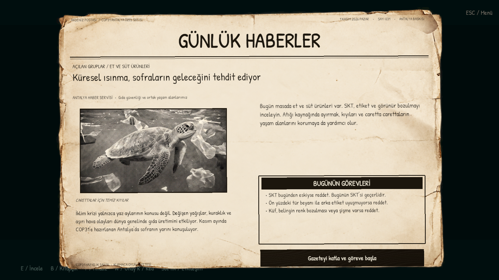
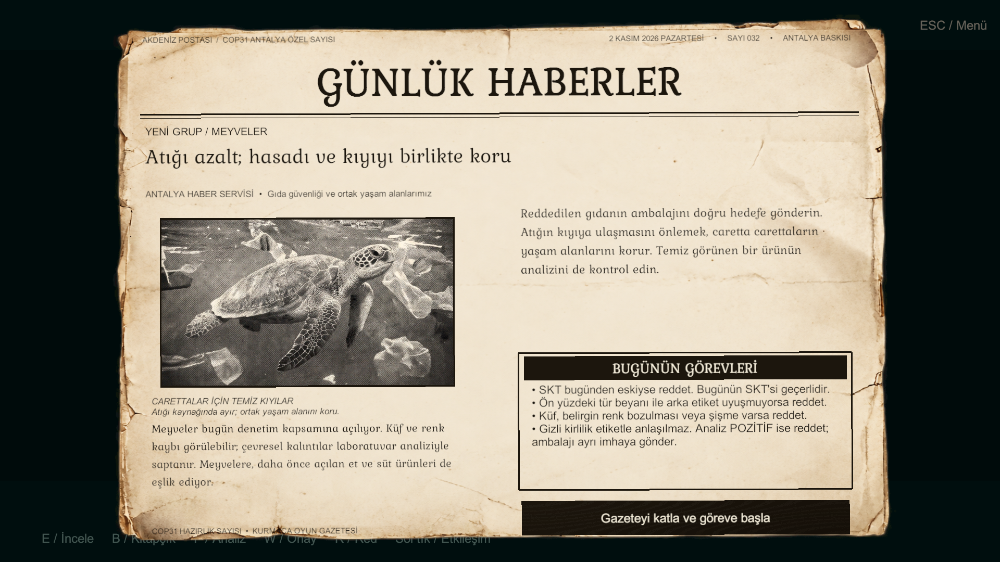
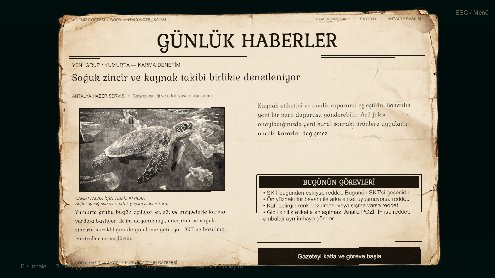

# Aktif kampanya ve sinematik doğrulaması — 1 Kasım 2026

Unity **6000.3.13f1**, Windows x64, D3D11 / RTX 3060 Laptop. Dal: `feat/lead-coastal-cinematic`.

| Kontrol | Sonuç |
|---|---|
| Unity testleri | **100/100 geçti**, başarısız/atlanan yok; son tam koşu 152.09 saniye. Interaction 1, Lead 33, Production 65, Rules 1 |
| Ürün / rapor / karar denetimi | **31 ürün, 1540 kontrol, 0 hata**. Gerçek faks kuyruğunda 31 ayrı rapor; doğru onay/red ve ayrıştırmada hata sayacı artmaz. Editor: GameUP32 → QA → Product inspection audit |
| SKT / numune ayrımı | Yoğurtların eski 2021 kapak baskısı temizlendi. Günle eşit SKT geçerli ve açıkça belirtilir; geçmiş SKT / fiziksel bozulma / kalıntı / tür / geri çağırma ayrı gösterilir. Nihai rapor ve karar aynı snapshot'tan gelir |
| Güncel yüklenen modeller | Kullanıcının 1 Kasım Trashbin.fbx ve buttons.fbx dosyaları birebir alındı; dört kutu, sergi kopyaları ve onay/red butonları güncellendi. Butonlar masa üzerinde, eski görsel kopyaları yok; EditorOnly sergi izolasyonu geçti |
| Bitişik geri dönüşüm kutuları | Dört kutu aralıksız, toplam 2.88 m sıra; collider'lar çakışmaz, WastePoint hedefleri yeni yerleşimle aynı. Oyuncunun gerçek etkileşim mesafesinden dört kutu da ayrı seçilir. Son ilgili kontroller **5/5 geçti**; güncel görsel Docs/Previews/InspectionAudit/RecyclingBins.png |
| Evrak ana menüsü / pause | Menü gerçek tesis kamerasını gösterir; ikinci oynanış sistemi veya AudioListener yoktur. Pause aynı pano/kâğıt düzenindedir; 4:3, 16:9 ve 21:9 menü görüntüsü kontrol edildi |
| El yazısı fontu | Etkin üç sahnedeki tüm Text bileşenleri, ürün baskıları ve kitap metinleri Patrick Hand; Türkçe karakterler ve tabela/gazete taşmaları kontrol edildi |
| Güncel kaynak entegrasyonu | Faruk `04a87a2/a9fee0f`, Esmanur `4b6292a`, Özgür `10bb33f`; mevcut sahne ve sinematik korunur |
| Kitapçık doğrulaması | Özgür b317b5f Book-Page Curl; gerçek sayfa çevirme, sürükleme ortasında kapatma/tekrar açma, gün 1–2–3 ve onaylanmış acil kural aktarımı geçti; metin gerçek HandbookContent/Flow kaynağından gelir |
| Bakanlık faksı | Gerçek faks/siren, hata bildirimi, analiz ve vardiya baskısı; T / eski raporu açma eylemi yok; normal F analizi korunur |
| Günlük yanlış sınırı | Yanlış karar ve yanlış ayrıştırma ayrı sayılır; üçüncü yanlışın bildirimi sonrası kayıp; her sabah/restart sıfır; eski callback ikinci kez sayılmaz |
| Sağ bant | Sağ duvar açıklığından kapalı servis kabul bölümü; 35.45 m rota ve kayıtlı köşe waypoint'i. Ürün oyuncunun doğrudan sağında x=2.1, z=-3.2 noktasında durur; masa ile boşluk korunur |
| İnceleme | Kilitli imleçte gerçek fare deltası ürünü döndürür; ekran konumuna bağlı sürükleme eşiği yoktur. Kamera sabit; nesne merkezine göre döner, yaklaşık 0.86 m normalize boyut; bırakınca özgün poz/ölçek geri gelir |
| Ürün baskıları | 31 üründe özgün albedo + ön/arka bilgiler tek UV atlasına işlenir. Kaynak modeller korunur; ayrı etiket mesh/Renderer yok; BC7/mipmap ve runtime texture üretimi yok. 198 kullanılmayan eski etiket asseti referans taramasından sonra çıkarıldı |
| Ses | First'te tek AudioManager/AudioListener, yedi kayıtlı kanal; analiz 0.95, okyanus menü/kıyı/çalışma alanında etkin. 86.064 sn dublaj sinematik saatiyle eşgüdümlü; uzun kayıtlar Streaming. Yazıcı ayrı kanalda tek baskı, mevcut raporu açmak sesi tekrarlamaz; native oynatım testleri geçti |
| Gazete referansı | Yıpranmış kâğıt, caretta halftone fotoğrafı, büyük başlık ve görev kutusu; üç günün metinleri kesilmez; faks/rapor aynı kâğıt dokusunda |
| Gerçek sahneler | First → Menu → Game; tek ApplicationRoot ve EventSystem |
| Atlanamayan açılış | 90 saniye; Esc / restart / karar girdileri atlatmaz; gün Boot durumunda kalır |
| Söz ekranı | Tam metin ve atıf siyah fonda; 1080p ve 720p görüntüsü kontrol edildi |
| Kamera rotası | Kıyı → tesis → iki afiş → masa; küre taramasıyla duvar kesişmesi yok; son poz çalışma kamerasıyla aynı |
| Carettalar | Esmanur'un 5 aktörü; doğru baş yönü; gerçek yüzgeç animasyonu; kavisli giriş, farklı dönüş yönleri, derinlik ve yatış; kıyıya dönmeyen yüzme |
| Logo ve efekt sırası | Yüzmeden sonra yatay merkezde yükselen logo; 44. saniyeden sonra sekiz renkte 24 büyük patlama; 52'de efektler kapanır |
| Logo kadrajı | Yükseliş ve kamera eğimi boyunca yatay merkez değişmez; orijinal renk ve oran; 1080p ve 720p görüntüsü |
| Giriş kapıları | Gerçek çerçevede kapalı çift kanat; 68.5–70.5 sn menteşeden açılma; kamera 72.8'de geçer; bitişte açık kalırlar |
| Dinamik geçiş geometrisi | Kapalı yapraklar geçidi kapatır; açılan yapraklar kamera küre taramasına engel olmaz; statik batch kapalı |
| Arka oda | Oranı korunan iki gerçek portre; iki arka köşede Türkiye/BM makam bayrakları, ağırlıklı taban ve dökümlü 3B kumaş |
| Tek sinematik saati | Kamera / logo / parçacık Timeline'ı ile aktör pozları ve altyazılar aynı zamandan örneklenir |
| Çevre modelleri | 20/20 kaynak projede; 16 aktif; eski dört kutu yeni Trashbin.fbx meshleriyle değiştirildi; xray parçaları korunur |
| Gerçek paket propları | Dokuz Director/Out of Order tabela, temiz yazı alanı ve sahil direği; Polygon Office afiş/tavan/ağaç/kaya/kutu/düğmeleri |
| Dağlar | 360° kayıtlı hacimli arazi; geçerli köşeler, zirve/vadiler, eğim/yükseklik rengi; runtime üretim yok |
| Kullanıcı yerleşimleri | Mevcut sahneye hedefli değişiklik; gizlenen dekor ve son elle yapılan yerleşimler korunur |
| Fiziksel belgeler | Kitapçık açıkken gerçek açık kitap; kapatınca kapalı kitap; gazete okunurken katlı kopya gizli |
| Portre kadrajı | Yazı yok; görüntü oranı korunur, çerçeve tamamen dolar, taşan kenarlar maskelenir |
| Ahşap çerçeve | Mevcut 4 afiş + 2 portrede SM_Prop_Blackboard_01; orijinal rim/bevel ve atlas; baskı/yerleşim korunur |
| Sanatçı Game Kit | Binanın arkasında 31 ürün + 16 önceki çevre parçası + 4 yeni kutu + caretta = 52 kaynak gösterimi |
| Sergi ayrımı | EditorOnly kök/çocuklar, katman 30; oyun kameraları çizmez; collider, Animator ve etkileşim hedefi yok |
| Kamera / ses devri | Açılıştan sonra tek etkin kamera ve AudioListener; gazete yalnız bitişten sonra açılır |
| URP assetleri | Polygon Office materyalleri, gerçek Stylized Water mesh/dokuları, EPO Render Graph feature; derleme ve shader hatası yok |
| Outline | Native çözünürlük; tek dilation; blur ve duvar arkasından görünüm yok |
| Kampanya | **3 gün, 8 + 10 + 13 = 31 ürün** |
| Kategori açılımı | İlk gün yalnız et/süt, ikinci gün meyve, üçüncü gün yumurta |
| Model kaynağı | Yalnız Esmanur'un 31 prefabı; bütün kaynaklar oynanışta |
| Sağlam/bozuk varyant | 62 kayıtlı prefab; aynı kaynak mesh'ler, bozuk görünüm için shader |
| Shader | Editor URP görüntülerinde ve aktif shader kontrollerinde hata yok |
| Doğru oynayış | **31/31 karar, 15/15 ayrıştırma, 340 puan** |
| Tümüne onay | 16/31 doğruluk; başarısız |
| Tümüne red | 15/31 doğruluk; başarısız |
| Haber / kural / fotoğraf | Günün açılan gruplarıyla eşleşiyor; RelatedRuleIds aynı günün InitialRules listesiyle aynı |
| Kasım haberi | Antalya sıcaklığı iddiası kaldırıldı; küresel ve yıl boyu süren iklim riski |
| Aktif balık içeriği | Ürün/haber yok; aktif sahne eski arşive bağlı değil |
| Acil faks | 3. gün üçüncü ürün ayrıştırması da bitince gelir |
| Geri çağırma sınırı | B kaynaklı süt faks öncesi geçer; B peynir faks sonrası reddedilir; B meyvesi kapsam dışıdır |
| Gazeteler | Üç baskının metni görünür ve kesilmiyor; gerçek katlama düğmeleriyle onay |
| Oda | Teşhir dolapları kaldırıldı; dört arka kutu raycast ile erişilebilir |
| Sol afiş | Başlık görünür ve kesilmiyor; başlık/fotoğraf yerleşimi ayrıldı, oyun görüntüsü kontrol edildi |
| Pause / restart | Analiz donar; eski rapor/callback reddedilir, sonuç sıfırlanır |
| Windows build | Kullanıcının isteğiyle alınmadı; doğrulama Editor kapsamındadır |

Tam kampanyalar Editor PlayMode'da gerçek assetler ve üretim portlarıyla yürütüldü. Bu dalın doğrulaması Editor PlayMode ve D3D11/URP görüntü kontrollerini kapsar. Yeni Windows build'i alınmadı.

Güncel tam koşu: `Logs/FacilityPolish/tests-final.xml` (59/59, 149.35 saniye) ve `tests-final.log`. UI son düzenlemesi ve eski etiketlerin çıkarılmasından sonra `references-final.xml` kontrolü de geçti (1/1). Başarılı üretim kayıtları `author-pass2.log`, `scenes-final.log`, `ui-final.log` dosyalarıdır. Menü görüntüleri `Docs/Previews/Menu`; yeni kitap ve pause görüntüleri `Docs/Previews/Facility`; workstation görüntüleri `Docs/Previews/Workstation`; önceki kıyı/sinematik görüntüleri `Docs/Previews/Coastal` altındadır. Yerel loglar Git'e eklenmez. [Tesis/UV/kitap/font uygulaması](Docs/FACILITY_POLISH.md) · [Workstation kapsamı](Docs/WORKSTATION_UPGRADE.md).

[Aktif plan](Docs/ACTIVE_CAMPAIGN.md) · [Ürün matrisi](Docs/CAMPAIGN_MATRIX.md) · [Model envanteri](Docs/MODEL_INVENTORY.md) · [Çevre envanteri](Docs/ENVIRONMENT_INVENTORY.md)

[Sahil, tesis, asset uyarlaması ve açılış](Docs/COASTAL_CINEMATIC.md)

