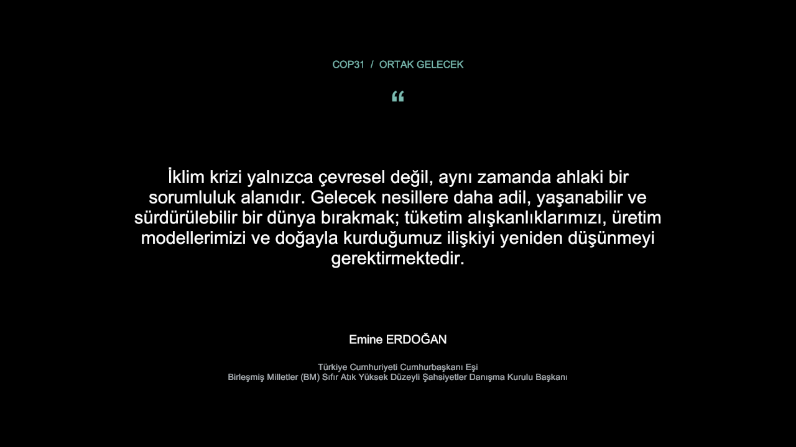
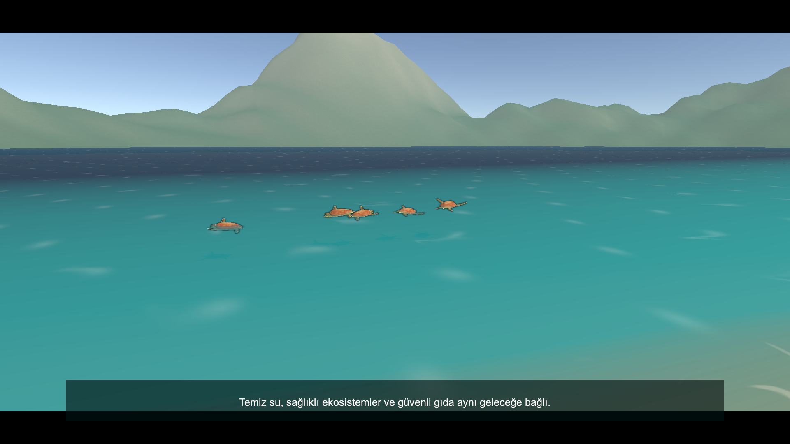
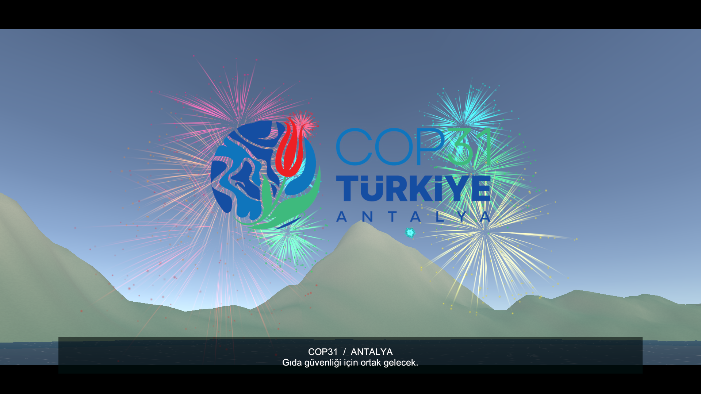
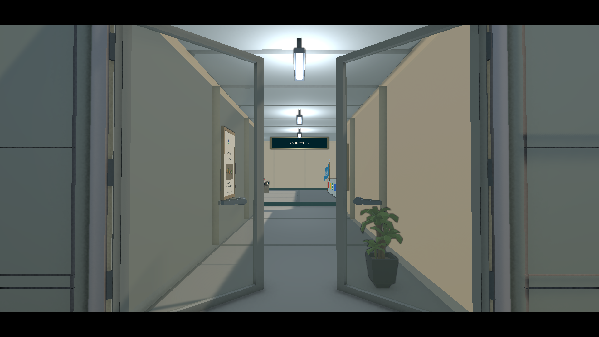
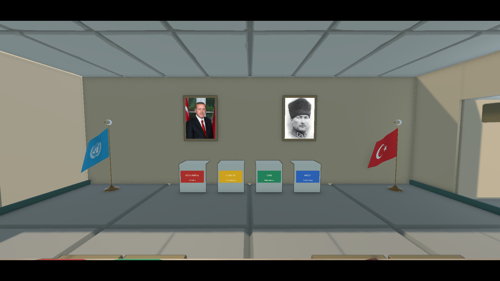
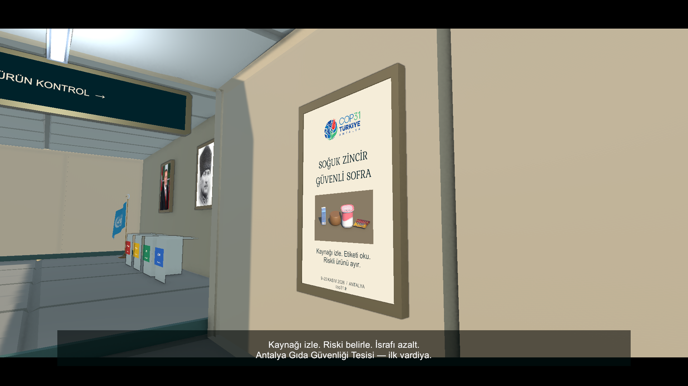

# Aktif kampanya ve sinematik doğrulaması — 1 Kasım 2026

Unity **6000.3.13f1**, Windows x64, D3D11 / RTX 3060 Laptop. Dal: `feat/lead-coastal-cinematic`.

| Kontrol | Sonuç |
|---|---|
| Unity testleri | **48/48 geçti**, başarısız/atlanan yok |
| T cihazı temizliği | T kısayolu, tekrar rapor akışı, hedef/etiket, faks modeli ve FaxPresenter kaldırıldı; normal F analizi korunur |
| Gerçek sahneler | First → Menu → Game; tek ApplicationRoot ve EventSystem |
| Atlanamayan açılış | 90 saniye; Esc / restart / karar girdileri atlatmaz; gün Boot durumunda kalır |
| Söz ekranı | Tam metin ve atıf siyah fonda; 1080p ve 720p görüntüsü kontrol edildi |
| Kamera rotası | Kıyı → tesis → iki afiş → masa; küre taramasıyla duvar kesişmesi yok; son poz çalışma kamerasıyla aynı |
| Carettalar | Esmanur'un 5 aktörü; doğru baş yönü; gerçek yüzgeç animasyonu; kavisli giriş, farklı dönüş yönleri, derinlik ve yatış; kıyıya dönmeyen yüzme |
| Logo ve efekt sırası | Yüzmeden sonra yatay merkezde yükselen logo; 44. saniyeden sonra sekiz renkte 24 büyük patlama; 52'de efektler kapanır |
| Logo kadrajı | Yükseliş ve kamera eğimi boyunca yatay merkez değişmez; orijinal renk ve oran; 1080p ve 720p görüntüsü |
| Giriş kapıları | Gerçek çerçevede kapalı çift kanat; 68.5–70.5 sn menteşeden açılma; kamera 72.8'de geçer; bitişte açık kalırlar |
| Dinamik geçiş geometrisi | Kapalı yapraklar geçidi kapatır; açılan yapraklar kamera küre taramasına engel olmaz; statik batch kapalı |
| Arka oda | Oranı korunan iki gerçek portre; iki arka köşede Türkiye/BM makam bayrakları, ağırlıklı taban ve dökümlü 3B kumaş |
| Tek sinematik saati | Kamera / logo / parçacık Timeline'ı ile aktör pozları ve altyazılar aynı zamandan örneklenir |
| Çevre modelleri | 16/16 kaynak projede; 14 aktif, T faksı ve sinyali istek gereği kullanım dışı; xray parçaları korunur |
| Gerçek paket propları | Dokuz Director/Out of Order tabela, temiz yazı alanı ve sahil direği; Polygon Office afiş/tavan/ağaç/kaya/kutu/düğmeleri |
| Dağlar | 360° kayıtlı hacimli arazi; geçerli köşeler, zirve/vadiler, eğim/yükseklik rengi; runtime üretim yok |
| Kullanıcı yerleşimleri | Mevcut sahneye hedefli değişiklik; gizlenen dekor ve son elle yapılan yerleşimler korunur |
| Fiziksel belgeler | Kitapçık açıkken gerçek açık kitap; kapatınca kapalı kitap; gazete okunurken katlı kopya gizli |
| Portre kadrajı | Yazı yok; görüntü oranı korunur, çerçeve tamamen dolar, taşan kenarlar maskelenir |
| Ahşap çerçeve | Mevcut 4 afiş + 2 portrede SM_Prop_Blackboard_01; orijinal rim/bevel ve atlas; baskı/yerleşim korunur |
| Sanatçı Game Kit | Binanın arkasında 31 ürün + 16 çevre parçası + caretta; gerçek mesh referansları eksiksiz |
| Sergi ayrımı | EditorOnly kök/çocuklar, katman 30; oyun kameraları çizmez; collider, Animator ve etkileşim hedefi yok |
| Kamera / ses devri | Açılıştan sonra tek etkin kamera ve AudioListener; gazete yalnız bitişten sonra açılır |
| URP assetleri | Polygon Office materyalleri, gerçek Stylized Water mesh/dokuları, EPO Render Graph feature; derleme ve shader hatası yok |
| Outline | Native çözünürlük; tek dilation; blur ve duvar arkasından görünüm yok |
| Kampanya | **3 gün, 8 + 10 + 13 = 31 ürün** |
| Kategori açılımı | İlk gün yalnız et/süt, ikinci gün meyve, üçüncü gün yumurta |
| Model kaynağı | Yalnız Esmanur'un 31 prefabı; bütün kaynaklar oynanışta |
| Sağlam/bozuk varyant | 62 kayıtlı prefab; aynı kaynak mesh'ler, bozuk görünüm için shader |
| Shader | Editor URP görüntülerinde ve aktif shader kontrollerinde hata yok |
| Doğru oynayış | **31/31 karar, 15/15 ayrıştırma, 340 puan** |
| Tümüne onay | 16/31 doğruluk; başarısız |
| Tümüne red | 15/31 doğruluk; başarısız |
| Haber / kural / fotoğraf | Günün açılan gruplarıyla eşleşiyor; RelatedRuleIds aynı günün InitialRules listesiyle aynı |
| Kasım haberi | Antalya sıcaklığı iddiası kaldırıldı; küresel ve yıl boyu süren iklim riski |
| Aktif balık içeriği | Ürün/haber yok; aktif sahne eski arşive bağlı değil |
| Acil faks | 3. gün üçüncü ürün ayrıştırması da bitince gelir |
| Geri çağırma sınırı | B kaynaklı süt faks öncesi geçer; B peynir faks sonrası reddedilir; B meyvesi kapsam dışıdır |
| Gazeteler | Üç baskının metni görünür ve kesilmiyor; gerçek katlama düğmeleriyle onay |
| Oda | Teşhir dolapları kaldırıldı; dört arka kutu raycast ile erişilebilir |
| Sol afiş | Başlık görünür ve kesilmiyor; başlık/fotoğraf yerleşimi ayrıldı, oyun görüntüsü kontrol edildi |
| Pause / restart | Analiz donar; eski rapor/callback reddedilir, sonuç sıfırlanır |
| Windows build | Kullanıcının isteğiyle alınmadı; doğrulama Editor kapsamındadır |

Tam kampanyalar Editor PlayMode'da gerçek assetler ve üretim portlarıyla yürütüldü. Bu dalın doğrulaması Editor PlayMode ve D3D11/URP görüntü kontrollerini kapsar. Yeni Windows build'i alınmadı.

Ham rapor: `Logs/art-frames-kit-tests.xml`. Hedefli sahne yenilemesi, mesh envanteri ve shader kontrolü: `Logs/art-frames-kit-author.log`; görüntüler: Docs/Previews/Coastal. Tam oynanış ve çalışma zamanı logo/efekt ekranı: `Logs/Visuals`. Yerel loglar Git'e eklenmez. Yeniden çalıştırma script'i sonuçları `Logs/production-tests.xml` adıyla yazar.

[Aktif plan](Docs/ACTIVE_CAMPAIGN.md) · [Ürün matrisi](Docs/CAMPAIGN_MATRIX.md) · [Model envanteri](Docs/MODEL_INVENTORY.md) · [Çevre envanteri](Docs/ENVIRONMENT_INVENTORY.md)

[Sahil, tesis, asset uyarlaması ve açılış](Docs/COASTAL_CINEMATIC.md)

