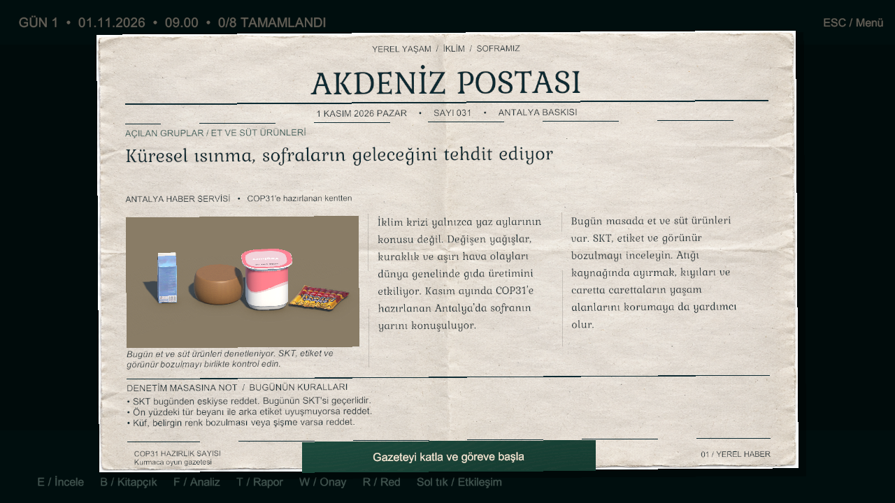
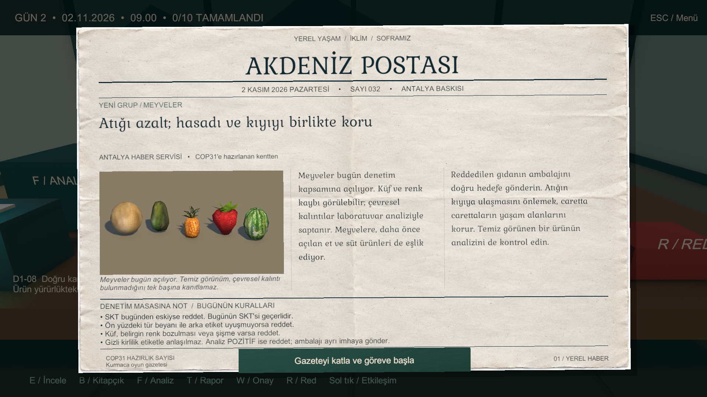
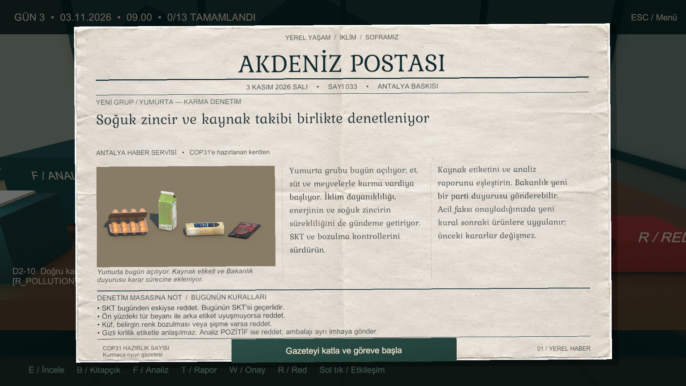
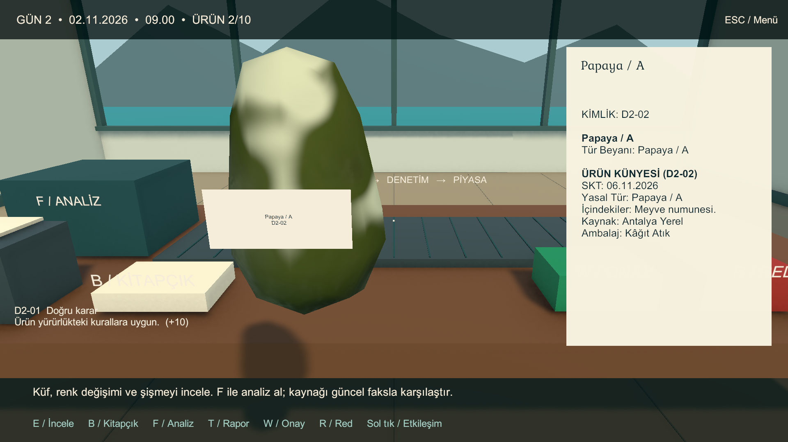
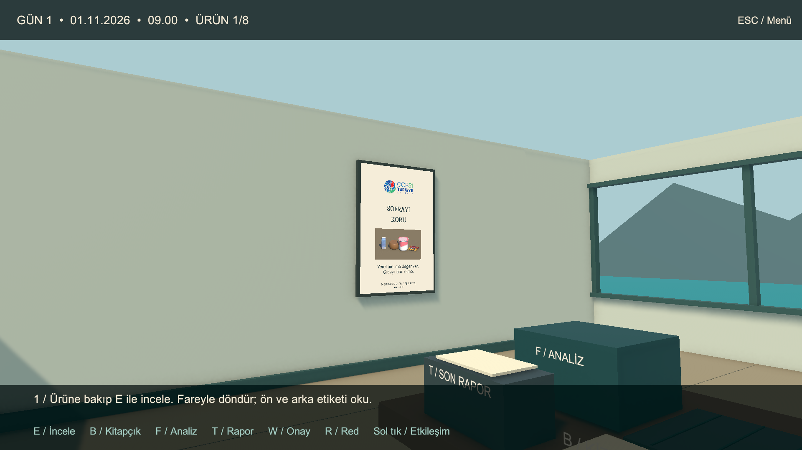

# Aktif kampanya doğrulaması — 31 Ekim 2026

Unity **6000.3.13f1**, Windows x64, D3D11 / RTX 3060 Laptop. Dal: `feat/lead-category-progression`.

| Kontrol | Sonuç |
|---|---|
| Unity testleri | **37/37 geçti**, başarısız/atlanan yok |
| Gerçek sahneler | First → Menu → Game; tek ApplicationRoot ve EventSystem |
| Kampanya | **3 gün, 8 + 10 + 13 = 31 ürün** |
| Kategori açılımı | İlk gün yalnız et/süt, ikinci gün meyve, üçüncü gün yumurta |
| Model kaynağı | Yalnız Esmanur'un 31 prefabı; bütün kaynaklar oynanışta |
| Sağlam/bozuk varyant | 62 kayıtlı prefab; aynı kaynak mesh'ler, bozuk görünüm için shader |
| Shader | Hata yok; Windows build'inde derlendi |
| Doğru oynayış | **31/31 karar, 15/15 ayrıştırma, 340 puan** |
| Tümüne onay | 16/31 doğruluk; başarısız |
| Tümüne red | 15/31 doğruluk; başarısız |
| Haber / kural / fotoğraf | Günün açılan gruplarıyla eşleşiyor; RelatedRuleIds aynı günün InitialRules listesiyle aynı |
| Kasım haberi | Antalya sıcaklığı iddiası kaldırıldı; küresel ve yıl boyu süren iklim riski |
| Aktif balık içeriği | Ürün/haber yok; aktif sahne eski arşive bağlı değil |
| Acil faks | 3. gün üçüncü ürün ayrıştırması da bitince gelir |
| Geri çağırma sınırı | B kaynaklı süt faks öncesi geçer; B peynir faks sonrası reddedilir; B meyvesi kapsam dışıdır |
| Gazeteler | Üç baskının metni görünür ve kesilmiyor; gerçek katlama düğmeleriyle onay |
| Oda | Teşhir dolapları kaldırıldı; dört arka kutu raycast ile erişilebilir |
| Sol afiş | Başlık görünür ve kesilmiyor; başlık/fotoğraf yerleşimi ayrıldı, oyun görüntüsü kontrol edildi |
| Pause / restart | Analiz donar; eski rapor/callback reddedilir, sonuç sıfırlanır |
| Windows build | **Başarılı**, BuildOptions.None; 157.966.128 bayt rapor boyutu |
| Windows açılışı | Normal oyuncu 10 saniye izlendi; istisna/eksik script/shader hatası yok |
| Oyuncu assembly'leri | Editor üreticileri, eski prototip backend'i ve test katalogları yok |

Tam kampanyalar Editor PlayMode'da gerçek assetler ve üretim portlarıyla yürütüldü. Normal Windows oyuncusunda ayrıca açılış kontrolü yapıldı. Ayrı PC'de tam manuel oynayış, son teslim kontrolüdür.

Ham rapor: `Logs/category-tests.xml`. Build: `Logs/category-build.log`. Açılış: `Logs/category-player.log`. Tam ekranlar: `Logs/Visuals`. Yerel çıktılar Git'e eklenmez. Yeniden çalıştırma script'i sonuçları `Logs/production-tests.xml` adıyla yazar.

[Aktif plan](Docs/ACTIVE_CAMPAIGN.md) · [Ürün matrisi](Docs/CAMPAIGN_MATRIX.md) · [Model envanteri](Docs/MODEL_INVENTORY.md)

