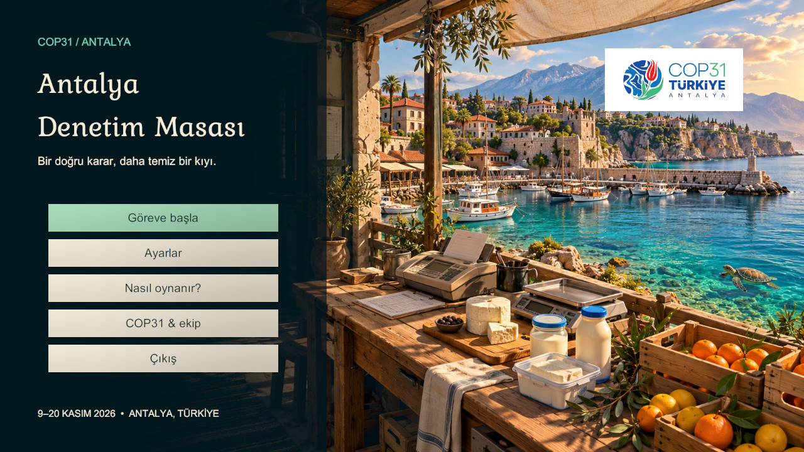

# Entegrasyon doğrulaması — 31 Ekim 2026

Ortam: Unity **6000.3.13f1**, Windows x64, NVIDIA RTX 3060 Laptop / D3D11. Üç sahne: First, Menu, Game.

## Sonuçlar

| Kontrol | Sonuç |
|---|---|
| Unity EditMode / gerçek PlayMode geçişleri | **34 / 34 geçti**, başarısız veya atlanan yok |
| Çekirdek akış ve belge testleri | 29 test geçti |
| Faruk'un kabul senaryoları | RulesEditModeTests kapsamındaki süit geçti |
| Sahne bağlantıları ve hedefler | Eksik script/referans yok; 12 ürün prefabı atanmış |
| Doğru kampanya | 12/12 karar, 6/6 ayrıştırma, **132 puan**, başarılı |
| Tümüne onay / tümüne red | Her ikisi %50 doğrulukla başarısız |
| Analiz sırasında pause | Zaman, ürün hareketi ve analiz durur; devamda rapor gelir |
| Restart / eski callback / menüye dönüş | Yeni RunId, temiz sonuç, eski rapor reddi; tek ApplicationRoot ve EventSystem |
| Ayarlar | Hassasiyet sahne geçişinde korunur; ortak ayarlar paneli çalışır |
| Görsel kontrol | Menü, ayarlar, rehber, ekip, gazete, inceleme, kitapçık, pause, analiz, acil faks, final |
| Çözünürlük | Ana menü ve gazete 1920×1080 ve 1280×720 kontrol edildi |
| Windows üretim build'i | **Başarılı**, BuildOptions.None; rapor boyutu 120.812.488 bayt |
| Normal Windows oyuncusu | Gizli D3D11 açılışı 10 saniye izlendi; istisna/eksik script kaydı yok |
| Oyuncu assembly içeriği | Prototip backend, smoke runner, test kataloğu, test harness ve eski InspectionService yok |

Testler gerçek kayıtlı sahneleri, Faruk'un assetlerini ve üretim portlarını kullanır. Üç tam kampanya Editor içindeki PlayMode'da yürütülür. Normal oyuncuda ayrıca açılış kontrolü yapılmıştır; bu, ayrı bir bilgisayarda tam manuel oynayışın yerine geçmez.

## Tekrar çalıştırma

Kullanım ve komutlar [LEAD_INTEGRATION.md](LEAD_INTEGRATION.md) içindedir. Ham rapor `Logs/production-tests.xml`, derleme kaydı `Logs/production-build.log`, açılış kaydı `Logs/production-player.log` ve tam görseller `Logs/Visuals` altındadır; üretilen yerel dosyalar Git'e eklenmez.

## Teslim sınırı

İki günlük P0 kampanyası bağlandı. Tartı/cetvel, yüzde ölçümü ve üçüncü gün P1 içerikleridir. Ekip dışından ilk oynayış, ayrı Windows PC'de donanım kontrolü ve sanatçının nihai oda düzenlemesi ayrıca yapılmalıdır. Balık/tepsi modeli açıkça atanmış basit bir Editor yapımı prefabdır; ürün havuzunda model bulunamadığında üretilen bir yedek nesne değildir.
